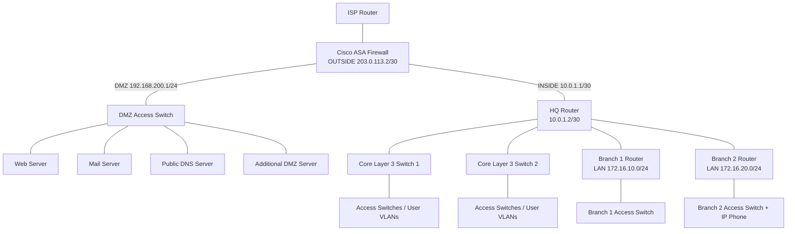

# Enterprise Campus Network with Branch WAN and ASA DMZ Firewall

**Cisco Packet Tracer | Routing & Switching | Network Security | Enterprise Lab**

## Project overview

A simulated enterprise network connecting a headquarters campus, two remote branches, an ISP edge, and a segmented demilitarized zone (DMZ). The topology combines Layer 2 segmentation, Layer 3 routing, gateway resilience, centrally delivered network services, and firewall security zoning. It is designed for hands-on Cisco networking and interview preparation.

> **Implementation honesty:** This repository documents a working/partly verified lab and its final planned security stage. VLAN/OSPF/branch/DMZ interface setup was reported functioning during the build; some specific features require re-verification from device configs. **NAT/PAT, DMZ end-to-end connectivity, public-server publishing, and final ACL/port-security validation have NOT been confirmed complete.** Sample configurations are labeled as examples, not copied device output.

## Architecture at a glance

Diagram is conceptual. Refer to the screenshot for the actual Packet Tracer cabling; do not interpret the Mermaid diagram as a port-by-port wiring record.

## Implemented / observed features

| Area | Technologies / purpose | Evidence status |
|---|---|---|
| Campus switching | Department VLANs, access/trunk links, Layer 3 SVIs | Reported implemented; config export needed |
| Campus services | DHCP, DHCP relay (`ip helper-address`), DNS | Reported working; IPs/pools need verification |
| Resilience and Layer 2 | STP/PVST, PortFast, BPDU Guard; HSRP attempted/configured | Configured in prior sessions; failover not conclusively tested |
| Dynamic routing | OSPF routes for seven campus subnets and two branch LANs | **Verified by HQ `show ip route`** |
| Branch WAN | HQ serial links to two branches | **Verified by HQ `show ip route`** |
| Firewall zoning | ASA interfaces named INSIDE, DMZ, OUTSIDE, levels 100/50/0 | **Verified by ASA `show run interface`** |
| HQ edge routing | Default route toward ASA (`10.0.1.1`) | **Verified by HQ `show ip route`** |
| Outbound PAT | Campus/branch address translation at ASA | **Proposed commands; not yet verified** |
| DMZ application connectivity | Web / mail / DNS server reachability and service tests | **Not yet end-to-end verified** |
| Internet-facing DMZ publication | Static NAT + inbound ACL for web server | **Not configured/verified** |
| Additional hardening | Restrictive inter-VLAN ACLs, switch port security | **Planned** |

## Addressing summary

| Component | Interface / purpose | Address / subnet | Confidence |
|---|---|---|---|
| HQ router | G0/2 toward ASA | `10.0.1.2/30` | Observed |
| ASA | G1/1 INSIDE | `10.0.1.1/30` | Observed |
| ASA | G1/2 DMZ | `192.168.200.1/24` | Observed |
| ASA | G1/3 OUTSIDE | `203.0.113.2/30` | Observed |
| ISP router | ASA-side next hop | `203.0.113.1/30` | **Assumed; verify** |
| HQ | G0/1 to campus core link | `10.0.0.2/30` | Observed |
| HQ | G0/0 to campus core link | `10.0.0.6/30` | Observed |
| HQ | Serial0/3/0 toward Branch 1 | `172.16.1.2/30` | Observed |
| HQ | Serial0/3/1 toward Branch 2 | `172.16.2.2/30` | Observed |
| Campus | seven OSPF routed VLAN networks | `10.10.10.0/24` through `10.70.10.0/24` (increments of 10) | Observed |
| Branch 1 | User LAN | `172.16.10.0/24` | Observed |
| Branch 2 | User LAN | `172.16.20.0/24` | Observed |
| DMZ servers | Hosts behind DMZ switch | `192.168.200.0/24`; **individual server IPs unknown** | Verify |

**Important:** `203.0.113.0/24` is the RFC 5737 TEST-NET-3 documentation range, not globally usable public Internet addressing. It is fine for an isolated Packet Tracer exercise. This lab's ISP tests demonstrate simulated routing, not real Internet connectivity.

## Why these technologies?

- **VLANs** reduce the Layer 2 broadcast scope and logically separate IT, Sales, HR, Finance, Guest, Management, and server traffic.
- **SVIs on multilayer switches** route between VLANs without routing every VLAN through a physical router link.
- **OSPF** learns routes dynamically across the headquarters and branches, avoiding a large collection of manually maintained routes.
- **STP** reduces the risk of Layer 2 loops when redundant switch paths exist.
- **HSRP** can provide a shared virtual default gateway when two eligible Layer 3 devices are correctly configured on the same VLAN.
- **DHCP/DNS** provide addressing and name resolution; DHCP relay helps clients reach a server in another VLAN.
- **ASA security zones** isolate the untrusted ISP, semi-trusted DMZ, and private campus.
- **NAT/PAT** (planned final configuration) allows many inside hosts to share one edge-facing address.
- **Static NAT + ACLs** (planned) publish only required services without opening the entire DMZ.

## Explore the documentation

1. [01 — Architecture, addressing and subnetting](docs/01-architecture-and-ip-plan.md)
2. [02 — VLANs, trunks, SVIs, STP, HSRP and campus services](docs/02-switching-and-campus-services.md)
3. [03 — OSPF, branches and routing workflow](docs/03-routing-and-branches.md)
4. [04 — Cisco ASA firewall: concepts and every relevant command explained](docs/04-asa-firewall-study-guide.md)
5. [05 — NAT, DMZ access and publishing: careful implementation guide](docs/05-nat-dmz-implementation.md)
6. [06 — Validation, screenshots and interview Q&A](docs/06-validation-and-interview.md)

## Skills demonstrated

`Cisco Packet Tracer` · `IPv4 / Subnetting` · `VLAN / 802.1Q` · `SVI` · `OSPF` · `STP` · `HSRP` · `DHCP Relay` · `DNS` · `Cisco ASA` · `Security Zones` · `Static Routing` · `NAT/PAT (in progress)` · `Troubleshooting`

## Repository completion steps

- [ ] Export sanitized running configurations from switches, routers and ASA.
- [ ] Confirm each VLAN ID ↔ subnet ↔ SVI IP mapping.
- [ ] Verify actual DMZ server IPs and services.
- [ ] Capture `show nat`, `show route`, `show xlate` after implementation.
- [ ] Test campus/branch to DMZ and ISP; attach evidence.
- [ ] Test firewall ACLs and web publishing from the outside network.
- [ ] Add the `.pkt` file **after checking it contains no real credentials or other sensitive information**.

> For study and portfolio use; sample commands are not production-ready security policy.
